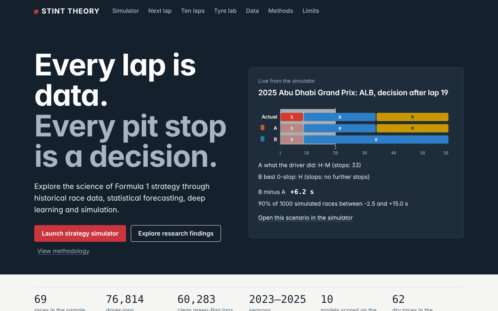
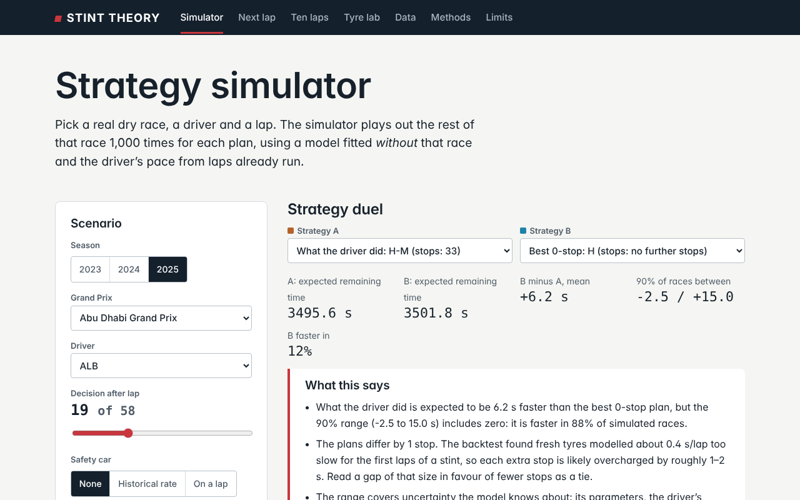

# STINT THEORY

**Every lap is data. Every pit stop is a decision.**

An open-source Formula 1 research platform comparing statistical,
machine-learning and deep-learning lap-time forecasts, and what they imply for race
strategy simulation.

Website: **https://nahianibnat-2000.github.io/stint-theory/**



## Research question

Can deep learning models predict Formula 1 lap times and tyre-related pace loss
more accurately than statistical and standard machine-learning models, and what
does that mean for strategy decisions?

## Findings so far

All figures are generated by the code in this repository; sources in brackets.

- **Next lap (Task 1, pre-registered, locked 2025 test races).** All five primary
  comparisons between the neural networks (MLP, LSTM, TCN) and XGBoost came out
  *equivalent* within the pre-registered ±0.01 s margin. The best models cut the
  error of repeating the last lap by about 12-13%. More architecture did not buy
  accuracy. (`research/results/final_test/report.md`)
- **Next ten laps (Task 2, pre-registered).** XGBoost beats repeating the last lap
  by about 1 s over ten laps; the LSTM is statistically worse than XGBoost, by an
  amount whose practical size is unclear. (`research/results/task2_test/report.md`)
- **Tyre-age effect (Task 3).** About 0.068 s (soft), 0.048 s (medium) and 0.042 s
  (hard) per extra lap of tyre age, after removing fuel and track effects. Raw slopes
  are near zero or negative because fuel burn hides tyre ageing.
  (`research/results/task3/report.md`)
- **Strategy simulator.** Single car against the clock, leave-race-out parameters,
  frozen after three backtests; its absolute-time error and biases are published.
  (`research/results/simulator/backtest.md`)

Limits: [docs/limitations.md](docs/limitations.md).

## Status

| part | status |
|---|---|
| Data pipeline (OpenF1 2023-2025, validation, cleaning, features, coverage audit) | **Done.** Coverage: `data/reports/coverage_report.md` (single source of truth for sample counts). |
| Statistical and ML models (persistence, compound drift, ridge, mixed effects, random forest, XGBoost) | **Done**, frozen after development. |
| Neural models (MLP, LSTM, TCN) | **Done**, frozen after development. |
| Task 1 final test (next lap) | **Done**, run once on the locked test set under `docs/preregistration.md`. |
| Task 2 final test (ten laps) | **Done**, run once under `docs/preregistration_task2.md`. |
| Task 3 tyre-age effect | **Done** (observational estimates with robustness checks). |
| Strategy simulator | **Done and frozen** after backtest 3. |
| Website | **Live.** Simulator with strategy duel, timeline, sensitivity and exports; result pages for Tasks 1-3. |
| Planned | Model comparison explorer, race explorer, featured race case study, research reliability page, paper. |

## Architecture

```
OpenF1 API ─> pipelines/ (ingest, validate, clean, features, audit) ─> data/processed (not in git)
                                                                     │
          models/ (Tasks 1-3, locked test, pre-registered comparisons) ┤─> research/results/*
          simulation/ (leave-race-out parameters, Monte Carlo, optimiser) ┘
                                                                     │
          webexport/ ─> web/public/data (derived results only) ─> web/ (React + Vite) ─> GitHub Pages
```

The browser runs a line-by-line JavaScript port of `simulation/` (`web/src/sim/`)
with the same random-number generator; `npm test` checks it against Python draw by
draw on the exported races.



## Quick start

```bash
python -m venv .venv
source .venv/bin/activate            # Windows Git Bash: source .venv/Scripts/activate
pip install -r requirements-dev.txt
python -m pytest -q                  # all tests run offline

# Feasibility run: three races from one season (about 1 minute)
python -m pipelines ingest --seasons 2023 --rounds 1-3 -v
python -m pipelines build --seasons 2023
python -m pipelines diagnose --seasons 2023
# -> data/reports/coverage_report.md and data/reports/diagnostics.md

# Full sample, 2023 to 2025 (roughly 25 minutes the first time; responses are cached)
python -m pipelines all --seasons 2023-2025 -v
```

Data comes from the free OpenF1 historical API. No account or key is needed.
Requests are spaced 2.1 s apart to stay inside the free tier. Set `STINT_CACHE`
to keep the response cache somewhere other than `.cache/`.

### Why not FastF1

Since mid-October 2026, Formula 1's timing archive (FastF1's source) requires a
paid F1 TV subscription, and GitHub Actions runners are blocked from it. That
breaks the zero-cost rule, so the pipeline reads OpenF1 instead. The price is a
shorter sample: 2023 to 2025 only.

### Run in GitHub Actions instead

Actions → **ingest** → Run workflow, enter seasons (and optionally rounds). Not yet
tested from Actions. The job caches OpenF1 responses between runs, uploads the processed tables as a private
build artifact for 30 days, and commits only the manifests and reports.

## Pipeline

```
OpenF1 ──ingest──> data/raw/<season>/R<nn>_<event>/   (Parquet + session_meta.json)
                      │
                  validate ──> errors exclude a race; warnings become row flags
                      │
                    clean ───> data/processed/laps_clean.parquet   (no rows dropped)
                      │
                  features ──> data/processed/features_next_lap.parquet
                      │
                    audit ───> data/reports/coverage_report.md, coverage.json
```

| module | job |
|---|---|
| `pipelines/openf1.py` | OpenF1 client (throttle, retries, JSON cache) and the adapter that rebuilds stints, in-laps, track status, deleted laps and positions. |
| `pipelines/ingest.py` | Download race sessions, store tables, write provenance (session key, time, row counts, SHA-256, reconstruction checks). Skips races already on disk. |
| `pipelines/validate.py` | Schema, duplicates, lap and stint consistency, tyre-life steps, sector sums, scheduled distance. |
| `pipelines/clean.py` | Harmonised driver-lap table with quality and exclusion flags. |
| `pipelines/features.py` | Next-lap features under a strict information rule, plus the target. |
| `pipelines/audit.py` | Coverage and quality report. |
| `pipelines/schema.py` | Data dictionary source; generates `docs/data_dictionary.md`. |

## Models

```bash
python -m models dev --quick -v   # smoke test on the real data, a few minutes
python -m models dev -v           # full run: tuning on 2024 + 12 development races
python -m models deep --quick -v  # Phase 3 smoke test
python -m models deep -v          # Phase 3 full run (needs the Phase 2 predictions)
# final test: once, after committing docs/preregistration.md
STINT_UNLOCK_TEST=I_HAVE_FROZEN_ALL_MODELS python -m models test -v
```

See [docs/methodology_models.md](docs/methodology_models.md) for the split, the
reference pace, each model and how they are compared.

## Documentation

- [Methodology](docs/methodology.md): sample, cleaning rules, information rule, why lap time is not tyre wear.
- [Data dictionary](docs/data_dictionary.md)
- [Limitations](docs/limitations.md)
- [data/README.md](data/README.md): what is and is not committed.

## Tests

`python -m pytest -q` covers validation, track-status parsing, compound mapping,
weather alignment, flagging without dropping, the OpenF1 client (cache, retries,
empty results), the OpenF1 adapter against a race with known stints, pit stops,
safety car and a deleted lap, race-control period rules, an end-to-end build, documentation of every column, and leakage. The leakage test
changes the future and checks that features do not move; a second test plants a
leak and checks that the first test catches it.

## Licence

Code: MIT (see `LICENSE`). Formula 1 timing data (via OpenF1) is not covered by
this licence and is not redistributed here.

## Website and deployment

```bash
python -m webexport              # results, reports and compact simulator inputs -> web/public/data
python -m webexport parity       # Python reference outputs for the JavaScript simulator test
cd web && npm install
npm test                         # JS simulator = Python to 1e-6 s; feature tests on real races
npm run dev                      # local preview at http://localhost:5173/stint-theory/
```

The site publishes derived results only, never lap times (see `webexport/export.py`).
The strategy simulator runs in the browser: `web/src/sim/` is a line-by-line port of
`simulation/` with the same random-number generator, checked draw by draw against
Python.

Pushing to `main` runs `.github/workflows/pages.yml`: `npm ci`, `npm test`, then
`npm run build` (which stops if `web/public/data` was not exported) and deploys to
GitHub Pages. Repository Settings → Pages → Source must be **GitHub Actions**.

## Data licensing

Formula 1 timing data belongs to Formula 1 and its data partners and is accessed
through the community-run OpenF1 API. It is not redistributed: raw and processed lap
tables are git-ignored, and the website publishes derived results only (model
metrics, estimates, simulator parameters, tyre stints and pit-stop laps, and
per-lap decision states whose pace term averages up to 30 laps). Code is MIT.

STINT THEORY is an independent research project, not affiliated with or endorsed
by Formula 1, the FIA, Pirelli or any team.
